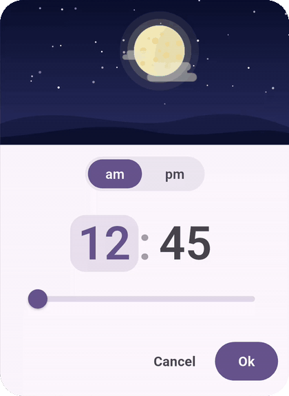
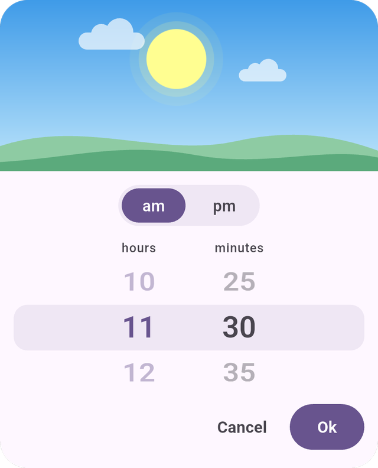

# DayNightTimePicker Plus

<!-- ALL-CONTRIBUTORS-BADGE:START - Do not remove or modify this section -->

[](#contributors)

<!-- ALL-CONTRIBUTORS-BADGE:END -->

> **Note**: This package is migrated from the original [`day_night_time_picker`](https://pub.dev/packages/day_night_time_picker) package to support the latest Flutter SDK and modern [`material_ui`](https://pub.dev/packages/material_ui) design package.

A day night time picker for Flutter with beautiful day and night animations.

> ### Default style:
>
> 

<br />
<br />

> ### IOS style:
>
> 

<br />
<br />

> ### [View it on pub.dev](https://pub.dev/packages/day_night_time_picker_plus)

---

## Installation

Add to pubspec.yaml.

```yaml
dependencies:
  day_night_time_picker_plus:
```

---

## Usage

To use plugin, just import package

```dart
import 'package:day_night_time_picker_plus/day_night_time_picker_plus.dart';
```

---

## Example

```dart
TextButton(
    onPressed: () {
        Navigator.of(context).push(
            showPicker(
                context: context,
                value: _time,
                sunrise: TimeOfDay(hour: 6, minute: 0), // optional
                sunset: TimeOfDay(hour: 18, minute: 0), // optional
                duskSpanInMinutes: 120, // optional
                onChange: onTimeChanged,
            ),
        );
    },
    child: Text(
        "Open time picker",
        style: TextStyle(color: Colors.white),
    ),
),
```

---

## Props

| Name                            | Description                                                                                                                        |                         Default                          |
| :------------------------------ | :--------------------------------------------------------------------------------------------------------------------------------- | :------------------------------------------------------: |
| **value**                       | **`Required`** Display value. It takes in [Time].                                                                                  |                                                          |
| **onChange**                    | **`Required`** Return the new time the user picked as [Time].                                                                      |                                                          |
| **isInlinePicker**              | Whether to render an inline widget.                                                                                                |                         `false`                          |
| **onChangeDateTime**            | _`Optional`_ Return the new time the user picked as [DateTime].                                                                    |                                                          |
| **onCancel**                    | _`Optional`_ Custom callback for the Cancel button. Note: if provided, it will override the default behavior of the Cancel button, so closing the picker is up to the callback. The Ok button is not affected. |                                                          |
| **is24HrFormat**                | Show the time in TimePicker in 24 hour format.                                                                                     |                         `false`                          |
| **accentColor**                 | Accent color of the TimePicker.                                                                                                    | `Theme.of(context).colorScheme.primary` |
| **unselectedColor**             | Color applied unselected options (am/pm, hour/minute).                                                                             | `Theme.of(context).colorScheme.onSurfaceVariant` |
| **cancelText**                  | Text displayed for the Cancel button.                                                                                              | `Cancel` |
| **okText**                      | Text displayed for the Ok button.                                                                                                  | `Ok` |
| **sunAsset**                    | Image asset used for the Sun.                                                                                                      |                      Asset provided                      |
| **moonAsset**                   | Image asset used for the Moon.                                                                                                     |                      Asset provided                      |
| **blurredBackground**           | Whether to blur the background of the [Modal].                                                                                     |                         `false`                          |
| **barrierColor**                | Color of the background of the [Modal].                                                                                            |                     `Colors.black45`                     |
| **borderRadius**                | Border radius of the [Container] in [double].                                                                                      | `24.0` |
| **elevation**                   | Elevation of the [Modal] in [double].                                                                                              |                          `12.0`                          |
| **dialogInsetPadding**          | Inset padding of the [Modal] in EdgeInsets.                                                                                        | `EdgeInsets.symmetric(horizontal: 40.0, vertical: 24.0)` |
| **barrierDismissible**          | Whether clicking outside should dismiss the [Modal].                                                                               |                          `true`                          |
| **showCancelButton**            | Whether to show the cancel button or not                                                                                           |                          `true`                          |
| **iosStylePicker**              | Whether to display a IOS style picker (Not exactly the same).                                                                      |                         `false`                          |
| **hourLabel**                   | The label to be displayed for `hour` picker. Only for _iosStylePicker_.                                                            |                        `'hours'`                         |
| **minuteLabel**                 | The label to be displayed for `minute` picker. Only for _iosStylePicker_.                                                          |                       `'minutes'`                        |
| **minuteInterval**              | Steps interval while changing `minute`. Accepts `TimePickerInterval` enum.                                                         |                 `TimePickerInterval.ONE`                 |
| **secondInterval**              | Steps interval while changing `second`. Accepts `TimePickerInterval` enum.                                                         |                 `TimePickerInterval.ONE`                 |
| **disableMinute**               | Disables the minute picker.                                                                                                        |                         `false`                          |
| **disableHour**                 | Disables the hour picker.                                                                                                          |                         `false`                          |
| **minHour**                     | Selectable minimum hour.                                                                                                           | `0` |
| **maxHour**                     | Selectable maximum hour.                                                                                                           | `23` |
| **minMinute**                   | Selectable minimum minute.                                                                                                         |                           `0`                            |
| **minSecond**                   | Selectable minimum second.                                                                                                         |                           `0`                            |
| **maxMinute**                   | Selectable maximum minute.                                                                                                         |                           `59`                           |
| **maxSecond**                   | Selectable maximum second.                                                                                                         |                           `59`                           |
| **displayHeader**               | Whether to display the sun moon animation.                                                                                         |                          `true`                          |
| **isOnValueChangeMode**         | Whether to hide okText, cancelText and return value on every onValueChange. **_Only for Inline widget_**                           |                         `false`                          |
| **focusMinutePicker**           | Whether or not the minute picker is auto focus/selected.                                                                           |                         `false`                          |
| **backgroundColor**             | Background color of the picker.                                                                                                    |                 `colorScheme.surface`                    |
| **themeData**                   | ThemeData to use for the widget.                                                                                                   |                   `Theme.of(context)`                    |
| **okStyle**                     | Ok button's text style.                                                                                                            |      `const TextStyle(fontWeight: FontWeight.bold)`      |
| **cancelStyle**                 | Cancel button's text style.                                                                                                        |      `const TextStyle(fontWeight: FontWeight.bold)`      |
| **buttonStyle**                 | Button's style. If `cancelButtonStyle` not provided, it applies to ok and cancel buttons.                                          | Filled `Ok` button and text `Cancel` button in the accent colors |
| **cancelButtonStyle**           | Cancel button style.                                                                                                               | Text button in the unselected color |
| **buttonsSpacing**              | Spacing between cancel and ok buttons.                                                                                             | `8` |
| **wheelHeight**                 | Only for _iosStylePicker_. Height of the Wheel                                                                                  | `120` |
| **hideButtons**                 | Whether to hide the buttons (ok and cancel).                                                                                       |                         `false`                          |
| **disableAutoFocusToNextInput** | Whether to disable the auto focus to the next input after current input is selected.                                               |                         `false`                          |
| **width**                       | Maximum width of the Picker container.                                                                                               |                `300` (`350` for iosStyle)                |
| **height**                      | Minimum height of the content below the sky.                                                                                              | `260`, grows with the content |
| **sunrise**                     | Time at which the sun rises and the moon sets in the sky.                                                                                                                      | `TimeOfDay(hour: 6, minute: 0)` |
| **sunset**                      | Time at which the sun sets and the moon rises in the sky.                                                                                                                       | `TimeOfDay(hour: 18, minute: 0)` |
| **duskSpanInMinutes**           | How long before the sunset the sky starts turning into dusk.                                                                                                              | `120` |
| **settings**                    | _`Optional`_ Data that might be useful in constructing a [Route].                                                                  |                                                          |

---

## Contributors

Thanks goes to these wonderful people:

<!-- ALL-CONTRIBUTORS-LIST:START - Do not remove or modify this section -->
<!-- prettier-ignore-start -->
<!-- markdownlint-disable -->
<table>
  <tbody>
    <tr>
      <td align="center" valign="top" width="14.28%"><a href="https://github.com/bousalem98"><br /><sub><b>Mohamed Salem</b></sub></a><br /><a href="https://github.com/bousalem98/day_night_time_picker_plus/commits?author=bousalem98" title="Code">💻</a> <a href="https://github.com/bousalem98/day_night_time_picker_plus/commits?author=bousalem98" title="Documentation">📖</a> <a href="#maintenance-bousalem98" title="Maintenance">🚧</a></td>
      <td align="center" valign="top" width="14.28%"><a href="https://github.com/subhamayd2"><br /><sub><b>Subhamay Dutta</b></sub></a><br /><a href="https://github.com/subhamayd2/day_night_time_picker_plus/commits?author=subhamayd2" title="Code">💻</a> <a href="https://github.com/subhamayd2/day_night_time_picker_plus/commits?author=subhamayd2" title="Documentation">📖</a></td>
      <td align="center" valign="top" width="14.28%"><a href="https://github.com/impure"><br /><sub><b>Andrew Zuo</b></sub></a><br /><a href="https://github.com/subhamayd2/day_night_time_picker_plus/commits?author=impure" title="Code">💻</a></td>
      <td align="center" valign="top" width="14.28%"><a href="https://www.linkedin.com/in/oude-mohammad/"><br /><sub><b>Mohammad Odeh</b></sub></a><br /><a href="https://github.com/subhamayd2/day_night_time_picker_plus/commits?author=MOOUDE" title="Code">💻</a></td>
      <td align="center" valign="top" width="14.28%"><a href="https://github.com/hashem78"><br /><sub><b>Hashem Alayan</b></sub></a><br /><a href="https://github.com/subhamayd2/day_night_time_picker_plus/commits?author=hashem78" title="Code">💻</a></td>
      <td align="center" valign="top" width="14.28%"><a href="https://github.com/gohdong"><br /><sub><b>gohdong</b></sub></a><br /><a href="https://github.com/subhamayd2/day_night_time_picker_plus/commits?author=gohdong" title="Code">💻</a></td>
      <td align="center" valign="top" width="14.28%"><a href="https://achim.io/"><br /><sub><b>nohli</b></sub></a><br /><a href="https://github.com/subhamayd2/day_night_time_picker_plus/commits?author=nohli" title="Code">💻</a></td>
      <td align="center" valign="top" width="14.28%"><a href="https://github.com/sander102907"><br /><sub><b>sander102907</b></sub></a><br /><a href="https://github.com/subhamayd2/day_night_time_picker_plus/commits?author=sander102907" title="Code">💻</a></td>
    </tr>
    <tr>
      <td align="center" valign="top" width="14.28%"><a href="https://asoteam.ir"><br /><sub><b>Sobhan Moradi</b></sub></a><br /><a href="#design-sobimor" title="Design">🎨</a></td>
      <td align="center" valign="top" width="14.28%"><a href="https://github.com/iaskari"><br /><sub><b>Omar Dahhane</b></sub></a><br /><a href="https://github.com/subhamayd2/day_night_time_picker_plus/commits?author=iaskari" title="Code">💻</a></td>
      <td align="center" valign="top" width="14.28%"><a href="https://github.com/fatihy101"><br /><sub><b>Fatih Yaman</b></sub></a><br /><a href="#design-fatihy101" title="Design">🎨</a></td>
      <td align="center" valign="top" width="14.28%"><a href="https://www.awesomejerry.space"><br /><sub><b>JerryShen</b></sub></a><br /><a href="https://github.com/subhamayd2/day_night_time_picker_plus/commits?author=awesomejerry" title="Code">💻</a></td>
      <td align="center" valign="top" width="14.28%"><a href="https://github.com/morio77"><br /><sub><b>本多健也</b></sub></a><br /><a href="https://github.com/subhamayd2/day_night_time_picker_plus/commits?author=morio77" title="Code">💻</a></td>
      <td align="center" valign="top" width="14.28%"><a href="https://github.com/TheGlorySaint"><br /><sub><b>Tempelritter</b></sub></a><br /><a href="https://github.com/subhamayd2/day_night_time_picker_plus/commits?author=TheGlorySaint" title="Code">💻</a> <a href="https://github.com/subhamayd2/day_night_time_picker_plus/commits?author=TheGlorySaint" title="Documentation">📖</a></td>
      <td align="center" valign="top" width="14.28%"><a href="https://github.com/Silfalion"><br /><sub><b>Silfalion</b></sub></a><br /><a href="https://github.com/subhamayd2/day_night_time_picker_plus/commits?author=Silfalion" title="Code">💻</a></td>
    </tr>
    <tr>
      <td align="center" valign="top" width="14.28%"><a href="https://github.com/guchengxi1994"><br /><sub><b>Chengxi Gu</b></sub></a><br /><a href="https://github.com/subhamayd2/day_night_time_picker_plus/commits?author=guchengxi1994" title="Code">💻</a></td>
      <td align="center" valign="top" width="14.28%"><a href="https://www.saifbillah.com"><br /><sub><b>Saif Billah</b></sub></a><br /><a href="https://github.com/subhamayd2/day_night_time_picker_plus/commits?author=saifb" title="Code">💻</a></td>
      <td align="center" valign="top" width="14.28%"><a href="https://github.com/markszente"><br /><sub><b>Mark Szente</b></sub></a><br /><a href="https://github.com/subhamayd2/day_night_time_picker_plus/commits?author=markszente" title="Code">💻</a></td>
      <td align="center" valign="top" width="14.28%"><a href="https://linkedin.com/in/rcjuancarlosuwu"><br /><sub><b>Juan Carlos Ramón Condezo</b></sub></a><br /><a href="#design-rcjuancarlosuwu" title="Design">🎨</a></td>
      <td align="center" valign="top" width="14.28%"><a href="https://github.com/Likenttt"><br /><sub><b>Chuanyi</b></sub></a><br /><a href="https://github.com/subhamayd2/day_night_time_picker_plus/commits?author=Likenttt" title="Documentation">📖</a></td>
      <td align="center" valign="top" width="14.28%"><a href="https://github.com/leonschwanitz"><br /><sub><b>Leon Schwanitz</b></sub></a><br /><a href="#design-leonschwanitz" title="Design">🎨</a></td>
      <td align="center" valign="top" width="14.28%"><a href="https://github.com/elmdecoste"><br /><sub><b>Liam DeCoste</b></sub></a><br /><a href="https://github.com/subhamayd2/day_night_time_picker_plus/issues?q=author%3Aelmdecoste" title="Bug reports">🐛</a></td>
    </tr>
    <tr>
      <td align="center" valign="top" width="14.28%"><a href="https://github.com/qqjjjj"><br /><sub><b>qqjjjj</b></sub></a><br /><a href="https://github.com/subhamayd2/day_night_time_picker_plus/commits?author=qqjjjj" title="Code">💻</a></td>
      <td align="center" valign="top" width="14.28%"><a href="https://github.com/moshe5745"><br /><sub><b>Moshe Yamini</b></sub></a><br /><a href="https://github.com/subhamayd2/day_night_time_picker_plus/commits?author=moshe5745" title="Code">💻</a></td>
      <td align="center" valign="top" width="14.28%"><a href="https://github.com/naipaka"><br /><sub><b>Ryota Kobayashi</b></sub></a><br /><a href="https://github.com/subhamayd2/day_night_time_picker_plus/commits?author=naipaka" title="Code">💻</a></td>
      <td align="center" valign="top" width="14.28%"><a href="https://github.com/Emon526"><br /><sub><b>Asraful Islam</b></sub></a><br /><a href="https://github.com/subhamayd2/day_night_time_picker_plus/commits?author=Emon526" title="Code">💻</a></td>
    </tr>
  </tbody>
</table>

<!-- markdownlint-restore -->
<!-- prettier-ignore-end -->

<!-- ALL-CONTRIBUTORS-LIST:END -->

This project follows the [all-contributors](https://github.com/all-contributors/all-contributors) specification. Contributions of any kind welcome!

---

## LICENCE

```
Copyright 2026 Mohamed Salem
Copyright 2023 Subhamay Dutta

Licensed under the Apache License, Version 2.0 (the "License");
you may not use this file except in compliance with the License.
You may obtain a copy of the License at

    https://www.apache.org/licenses/LICENSE-2.0

Unless required by applicable law or agreed to in writing, software
distributed under the License is distributed on an "AS IS" BASIS,
WITHOUT WARRANTIES OR CONDITIONS OF ANY KIND, either express or implied.
See the License for the specific language governing permissions and
limitations under the License.
```
